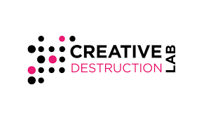

```{=html}
<div class="hero-video-container">

  <video class="hero-video" autoplay muted loop playsinline preload="auto" poster="images/hero-background.jpg">
    <source src="images/try_this_Cinematic_technolog.mp4" type="video/mp4">
  </video>

  <div class="hero-video-overlay">
    <section class="about-hero">
      <h1>Pacific TechFronts Lab</h1>

      <p class="tagline">
        Turning data, research, and AI innovation into smarter decisions and measurable impact.
      </p>

      <p>
        Pacific TechFronts Lab is a consulting and innovation lab specializing in data analytics, 
        business intelligence, applied research, artificial intelligence, and professional training. 
        We help organizations transform complex data into actionable intelligence, develop AI-driven solutions, 
        strengthen analytics capabilities, and design evidence-based strategies that accelerate digital transformation and sustainable growth.
      </p>
    </section>
  </div>

</div>
```

Our lab supports organizations across diverse sectors through data analytics consulting, business intelligence, 
dashboard development, applied research, and AI-driven solutions that enable informed decision-making and sustainable growth.

```{=html}
<div class="home-transition">
  <h2>From Data to Strategic Action</h2>
  <p>
    We help organizations move from fragmented data to clear insight, practical strategy,
    and measurable impact.
  </p>
</div>
```

## What We Do

```{=html}
<div class="service-grid">
  <div class="service-card">
    <h3>Data Analytics</h3>
    <p>We design analytical workflows, predictive models, and decision-support tools that help organizations understand performance, risk, and opportunity.</p>
  </div>

  <div class="service-card">
    <h3>Business Intelligence</h3>
    <p>We build dashboards, KPI systems, executive reporting tools, and performance-monitoring solutions that turn operational data into clear insight.</p>
  </div>

  <div class="service-card">
    <h3>Applied Research</h3>
    <p>We support evidence-based decision-making through impact evaluation, policy analysis, market research, and digital economy research.</p>
  </div>

  <div class="service-card">
    <h3>Training &amp; Capacity Building</h3>
    <p>We deliver customized training in analytics, AI, business intelligence, research methods, and digital transformation for teams and leaders.</p>
  </div>
</div>
```

```{=html}
<div class="home-transition">
  <h2>Analytics, AI, and Research in One Place</h2>
  <p>
    Pacific TechFronts Lab combines technical analytics, applied research, and training
    to support smarter decision-making.
  </p>
</div>
```

## Solutions We Deliver

- Executive dashboards and KPI reporting systems
- AI and machine learning decision-support tools
- Business intelligence and performance analytics
- Workforce and productivity analytics
- Program evaluation and impact measurement
- AI readiness and digital transformation strategy
- Financial, risk, and sustainability analytics
- Training programs for analytics teams and decision-makers

```{=html}
<div class="home-transition">
  <h2>Built for Decision-Makers</h2>
  <p>
    Reliable dashboards, evidence, and actionable recommendations for executives,
    program leaders, researchers, and teams.
  </p>
</div>
```

## Featured Projects

```{=html}
<div class="featured-gallery">
  <h3>Smart Food Recovery &amp; Sustainability Dashboard</h3>
  <p>An interactive analytics dashboard with AI/ML enhancements for forecasting, anomaly detection, reporting, and sustainability decision-making.</p>

  <h3>Venture Analytics &amp; Survival Risk Analysis</h3>
  <p>A data-driven framework for assessing venture performance, startup risk, and business survival patterns.</p>

  <h3>AI-Enhanced Credit Scoring</h3>
  <p>Machine learning approaches for assessing creditworthiness, with attention to financial inclusion and responsible AI.</p>
</div>
```

## Recent Analytics Engagements

```{=html}
<div class="logo-gallery static-logo-gallery client-logo-gallery">
  
  
  
  
  
  
</div>
```